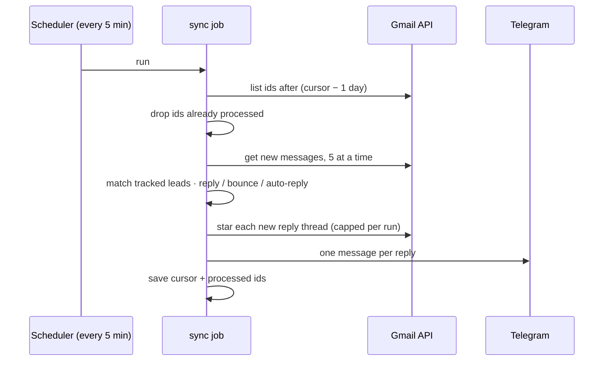

# gmail-reply-tracker

**Never miss a reply from a lead again.** A small job that watches a Gmail inbox for replies from the people you are tracking, stars the thread so it stands out, sends you a Telegram message with the reply text, and writes each event as JSON for your CRM, spreadsheet or email sequencer. Bounces and out-of-office replies are recognised and kept apart.

> Part of the [AutoNexus Labs](https://autonexuslabs.com) automation portfolio. The demo runs on a fictional mailbox in the Gmail API's own message format.

## The problem

A reply to outreach lands in the same inbox as newsletters, receipts and notifications. It gets read on a phone, marked read, and forgotten. Meanwhile the automated follow-up goes out two days later to someone who already said yes, or already said "who is this?".

## What it does

Two scheduled runs a day apart (`npm run demo`, no Google account needed):

```text
── Run 1 · Tue 18:00 UTC (first run, 30-day backfill) ─────────

  ┌ Telegram (dry run)
  │ 📩 Reply from maria@northwind-heating.example
  │ Re: Missed calls at Northwind Heating
  │
  │ Yes, send the demo over. We lose a lot of calls on Saturdays.
  └

query:   in:inbox after:2026/09/06 -from:me -category:promotions -category:social
scanned: 5 new messages, 4 from tracked leads
  reply      dev@cedarvalleyhvac.example  ★ starred
  bounce     jo@ironwoodair.example
  auto_reply office@oakline.example
  reply      maria@northwind-heating.example  ★ starred

── Run 2 · Wed 18:00 UTC (incremental) ────────────────────────

query:   in:inbox after:2026/10/05 -from:me -category:promotions -category:social
scanned: 2 new messages, 2 from tracked leads
  reply      info@pacificcomfort.example  ★ starred
  reply      maria@northwind-heating.example  (thread already starred)
```

The newsletter in the same inbox is ignored. The alert shows only the new text of the reply, not the quoted thread under it.

## How it works



- **Incremental.** A cursor stores the last day scanned. Each run reads only from that day on, so a run takes a second or two instead of scanning months of mail and timing out a serverless function. The last day is always re-read, because Gmail can index a message a moment after it arrives, and processed ids make the re-read free.
- **Capped writes.** The first run after install may find months of replies. Stars are capped per run and sent in small parallel batches, so it catches up over a few runs instead of spending one run's whole time budget on writes.
- **One star per thread**, even when a thread got two replies between runs.
- **Bounces are matched by body.** A bounce comes from `mailer-daemon`, and the lead's address is inside the message.
- **Narrow scope.** `gmail.modify` is the smallest Gmail scope that allows starring. The job cannot send mail.
- **No SDK.** Four REST calls over `fetch`, with the access token refreshed on demand.

## Quick start

Offline demo:

```bash
git clone https://github.com/autonexuslabs/gmail-reply-tracker
cd gmail-reply-tracker
npm test
npm run demo
```

Your own inbox:

1. Google Cloud console: enable the **Gmail API**, create an OAuth client ID of type **Desktop app**.
2. `cp .env.example .env`, fill in the client id and secret.
3. `npm run auth`, approve in the browser, paste the printed `GMAIL_REFRESH_TOKEN` into `.env`.
4. Put the addresses you are tracking in `leads.txt` (one per line, or paste a CSV).
5. `npm run sync`. Schedule it every 5 minutes with cron, Cloud Scheduler or GitHub Actions.

Optional: set `TELEGRAM_BOT_TOKEN` and `TELEGRAM_CHAT_ID` for alerts (see [telegram-watchdog](https://github.com/autonexuslabs/telegram-watchdog) for bot setup). Events are appended to `replies.jsonl`, which [email-sequence-sender](https://github.com/autonexuslabs/email-sequence-sender) reads to stop sequences and suppress opt-outs.

No dependencies. Node 20+.

## Project layout

```text
src/gmail.js        OAuth refresh + list, get, star over fetch
src/parse.js        headers, nested text/plain, quoted-history stripping, reply kind
src/sync.js         cursor, overlap, processed ids, star cap, events
src/notify.js       Telegram alert, dry-run when unconfigured
src/mockClient.js   in-memory Gmail for the demo and tests
bin/auth.js         one-time OAuth consent on a local loopback port
bin/sync.js         one scheduled run
test/               node:test unit tests
```

## Built by

[AutoNexus Labs](https://autonexuslabs.com): AI automation, lead pipelines and data tooling for small businesses.
Want your inbox wired into your pipeline? Email **contact@autonexuslabs.com**.

## License

MIT
